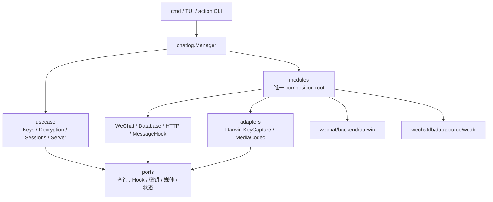

# 项目架构

Chatlog Alpha 当前是 **macOS-only** 应用。代码按入口、应用编排、用例、端口、业务服务和基础设施适配器分层；生产实现只在 composition root 中绑定。

## 依赖方向



允许的方向是从入口和装配层指向用例、端口与下层能力。`ports` 不依赖 HTTP、数据库实现、用例、适配器或 WCDB；`usecase` 不依赖 transport、storage、composition root 和 Darwin 实现。

## 目录职责

| 目录 | 职责 | 约束 |
| --- | --- | --- |
| `cmd/chatlog` | CLI 参数、输出与入口 | 不创建业务服务图 |
| `internal/chatlog` | Manager、TUI 与入口协调 | 只委派用例和已装配服务 |
| `internal/chatlog/usecase` | 密钥、会话、server 工作流 | 只依赖消费方定义的状态接口、领域模型和 `ports` |
| `internal/chatlog/ports` | 跨层 DTO 与能力接口 | 不暴露 WCDB、Darwin、HTTP 或 messagehook 实现类型 |
| `internal/chatlog/modules` | 唯一生产 composition root | 绑定所有具体适配器并建立共享服务图 |
| `internal/chatlog/adapters` | 平台和媒体适配器 | 实现 `ports`，不向用例泄漏具体状态 |
| `internal/chatlog/http` | HTTP transport 与 feature-local routes | 依赖本地窄接口和 `ports`，不依赖数据库/messagehook 实现 |
| `internal/chatlog/database` | 数据库服务与查询映射 | 通过 `OpenDB`、`HookFactory` 接入基础设施 |
| `internal/chatlog/messagehook` | 消息扫描、规则、投递与 outbox | 对外只返回 `ports` DTO |
| `internal/chatlog/wechat` | 账号发现与密钥工作流 | 平台能力由 `backend.Backend` 提供 |
| `internal/wechatdb` | 存储领域和 WCDB 数据源 | 不参与应用层生命周期选择 |

## Composition root

`modules.Adapters` 显式列出生产运行必需的能力：

```go
type Adapters struct {
    Platform   backend.Backend
    OpenDB     database.OpenDB
    OpenHook   database.HookFactory
    KeyCapture ports.KeyCapture
    MediaKeys  ports.MediaCodec
}
```

`modules.DarwinFactory` 是当前生产绑定点。`Build` 只构造服务，不启动进程、监听器或数据库；缺失能力会在装配时直接报错。测试通过 `modules.NewFactory(modules.Adapters{...})` 注入 fixtures。

## 用例与状态端口

Manager 不再包含密钥提取、会话刷新或 headless server 的具体流程：

- `usecase.Keys`：数据库密钥、图片密钥、Frida capture 和媒体 key 应用；
- `usecase.Sessions`：会话刷新与最新会话读取；
- `usecase.Server`：数据库直读启动、状态发布与信号关闭。

每个用例定义自身所需的最小状态接口。`ctx.Context` 是适配这些接口的外层状态对象，不被用例作为具体类型导入。

## 平台与媒体适配器

- `internal/wechat/backend.Backend` 组合进程发现、密钥提取和页面解密算法；
- `internal/chatlog/adapters/darwin.KeyCapture` 把 Darwin/Frida 结果封装为 typed opaque `ports.KeyCaptureState`；
- `internal/chatlog/adapters/media.Keys` 同时实现窄接口 `MediaKeys` 和完整 `MediaCodec`；
- 具体 Darwin、WCDB 和 `dat2img` import 只允许出现在 `modules` 或 `adapters`。

新增实现时只增加 adapter 并更新 `modules.Adapters`，不用修改用例或 HTTP handler。

## HTTP feature modules

路由注册由 feature 文件本地负责，`route.go` 只做组合：

- `route_chat.go` / `route_new_messages.go`
- `route_social.go`
- `route_contacts.go`
- `route_media*.go`
- `route_database.go`
- `route_hooks.go`

HTTP 的数据库依赖由 `DatabaseStatus`、`ChatQuery`、`AddressBookQuery`、`MediaQuery`、`DatabaseInspector`、`SocialQuery` 和 `HookAdmin` 等消费方接口组成。跨层查询、Hook 状态和事件均使用 `ports` DTO。

## 实时消息增量流

`internal/chatlog/database/message_changes.go` 是消息变更的唯一后台协调器：

- 复用 WCDB 的 `message` / `session` 文件事件并合并同一批 WAL/SHM 通知；
- 每次事件只读取一次完整会话快照；消息文件事件先读取变更分片的 `sqlite_master`，再用批量 `EXISTS` 按各会话游标筛出真正新增的 `Msg_<talker-md5>`，最后只读取命中的分片与会话；
- 定向分片读取不依赖 `SessionTable.last_timestamp`，因此会话水位短暂落后时仍能同步最新消息；仅不带文件名的兼容事件使用会话水位路径；
- 通过 `ports.MessageChangeFeed` 把同一批不可变消息扇出给实时推送和 OCR，消费者不再分别打开消息分片；
- 每个消费者保留自身持久水位，短时内存回放只负责启动重叠，重复批次按业务游标自然去重；
- 分片查询失败指数重试，消费者队列提供背压，并在仪表盘暴露查询次数、发布量、积压、回放缓存和最新同步延迟。

启动时仍各执行一次持久水位补齐，用来覆盖进程离线窗口；运行期间只响应数据库变更，不进行周期兜底扫描。

## 聚焦文件

历史热点已按职责拆分：

- WeChat：`service.go`、`decrypt_files.go`、`db_keys.go`
- MessageHook：`service.go`、`event.go`、`rules.go`、`media.go`、`delivery.go`、`store.go`
- WCDB API：client、messages、query、paths、只读加密 VFS、提交态 WAL 覆盖
- WCDB datasource：messages、contacts、media、SNS、inspector、search
- TUI：app、menu、settings、accounts

生产 Go 文件上限为 800 行，并由架构测试强制执行；当前最大文件低于该上限。

## 类型与配置边界

- 密钥提取请求统一使用 `key.Request` 和 typed context key；
- 只有 `internal/wechat/key/request.go` 可以调用 `context.WithValue`；
- HTTP、Database、WeChat 的配置分别拆为 network/media/hook、storage/runtime、decrypt capability；
- storage 结果在数据库边界映射为 `ports.Contacts`、`ports.ChatRooms`、`ports.Sessions`；
- messagehook 的事件和运行状态通过 `ports.HookEvent`、`ports.HookRuntimeStats` 返回。

## 生命周期

`modules.Services` 管理共享服务图：

1. 启动数据库；
2. 数据库创建并运行注入的 messagehook runtime；
3. 启动 HTTP；
4. HTTP 启动失败时回滚数据库；
5. 退出时停止 HTTP、messagehook 和数据库。

`usecase.Server` 负责启动原始数据库直读和 signal-driven shutdown。构造函数不启动外部资源。

## 自动架构契约

`architecture/contracts_test.go` 固化：

- macOS-only 源码和发布目标；
- 业务服务只在 composition root 构造；
- 分层 import 方向；
- 具体 adapter import 不越界；
- 生产 Go 文件不超过 800 行；
- 提取请求必须使用 typed context。

运行全部验收：

```bash
go test -tags sqlite_fts5 ./...
go test -tags sqlite_fts5 -race ./...
go vet -tags sqlite_fts5 ./...
make build
go test -tags sqlite_fts5 ./architecture
git diff --check
```

逐项评分和证据见 [`MODULARITY_SCORECARD.md`](MODULARITY_SCORECARD.md)。
